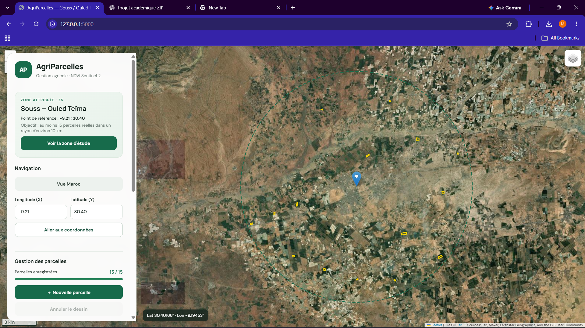

# 🌱 AgriParcelles — Application Web de Gestion des Parcelles Agricoles et de Suivi du NDVI


**Projet académique de Web-Mapping — Institut Agronomique et Vétérinaire Hassan II (IAV Hassan II)**  
**Département :** DSIA — Option IDSA  
**Année universitaire :** 2026–2027  
**Zone d'étude :** Souss – Ouled Teïma (Z5), Maroc

---

## 1. Présentation du projet

AgriParcelles est une application de Web-Mapping destinée à la gestion et au suivi des parcelles agricoles à l'aide des technologies géospatiales et de la télédétection.

Le projet répond au besoin de disposer d'un outil centralisé permettant de localiser les parcelles agricoles, d'enregistrer leurs caractéristiques, de gérer leurs géométries et de suivre l'état de leur végétation à partir d'images satellitaires Sentinel-2.

L'application intègre un système d'information géographique web avec une base de données spatiale et un service de traitement distant basé sur Google Earth Engine.

Le projet est appliqué à la zone agricole de **Souss – Ouled Teïma**, au Maroc, dans le cadre du cours de Web-Mapping de l'IAV Hassan II.

## 2. Objectifs

Les principaux objectifs du projet sont :

- Développer une application web de gestion des parcelles agricoles.
- Digitaliser et enregistrer des polygones agricoles à partir de l'imagerie satellite.
- Stocker les données attributaires et géométriques dans une base spatiale.
- Calculer automatiquement la superficie des parcelles.
- Exploiter les images Sentinel-2 pour le suivi de la végétation.
- Calculer le NDVI moyen de chaque parcelle sur une période donnée.
- Représenter cartographiquement l'état de la végétation à l'aide d'une symbologie thématique.

## 3. Fonctionnalités principales

### Cartographie et navigation

- Affichage cartographique interactif avec Leaflet.
- Basculement entre les fonds Terrain et Satellite.
- Affichage de la zone d'étude autour d'Ouled Teïma.
- Navigation, zoom et positionnement par coordonnées WGS84.
- Affichage et masquage de la couche des parcelles.
- Panneau latéral rétractable.

### Gestion des parcelles agricoles

- Digitalisation de polygones avec Leaflet-Geoman.
- Enregistrement des informations agricoles.
- Gestion du numéro de parcelle, de l'agriculteur, de la culture et de la production.
- Calcul automatique de la superficie en hectares.
- Affichage des attributs dans des fenêtres contextuelles.
- Navigation entre les parcelles enregistrées.
- Suppression d'une parcelle après confirmation.

### Suivi de la végétation par télédétection

Le suivi de la végétation repose sur le **Normalized Difference Vegetation Index (NDVI)** calculé à partir des bandes rouge (B4) et proche infrarouge (B8) des images Sentinel-2.

L'indice est calculé selon la formule :

\[
NDVI = \frac{B8-B4}{B8+B4}
\]

Le traitement utilise Google Earth Engine et la collection :

`COPERNICUS/S2_SR_HARMONIZED`

Les principales opérations comprennent :

1. Filtrage des images selon l'emprise géographique et la période demandée.
2. Exclusion des scènes présentant une couverture nuageuse supérieure ou égale à 30 %.
3. Masquage des pixels à partir de la bande de classification SCL, en conservant les classes 4 et 5.
4. Calcul du NDVI pour chaque image.
5. Calcul de la moyenne temporelle.
6. Calcul du NDVI moyen sur la géométrie de la parcelle.

### Classification thématique du NDVI

Les parcelles sont représentées selon quatre classes d'état de végétation :

| NDVI | Interprétation | Couleur |
|---|---|---|
| NDVI < 0,2 | Sol nu ou végétation très faible | Rouge |
| 0,2 à < 0,4 | Végétation faible | Orange |
| 0,4 à 0,6 | Végétation modérée | Jaune |
| NDVI > 0,6 | Végétation dense | Vert |

La coloration est basée sur le NDVI moyen de chaque parcelle. Elle ne représente pas une variation pixel par pixel à l'intérieur du polygone.

## 4. Architecture technique

L'application repose sur une architecture client-serveur organisée autour de quatre composants principaux.

| Couche | Technologies | Rôle |
|---|---|---|
| Client | HTML, CSS, JavaScript, Leaflet | Interface cartographique et interactions |
| Serveur | Python, Flask | API REST et traitement des requêtes |
| Base spatiale | SQLite, SpatiaLite | Stockage attributaire et géométrique |
| Télédétection | Google Earth Engine | Traitement des images Sentinel-2 et calcul du NDVI |

### Architecture des échanges

**Navigateur → API Flask → Base SpatiaLite**

Pour le calcul du NDVI :

**Navigateur → API Flask → Google Earth Engine → API Flask → Navigateur**

Les identifiants et paramètres de connexion ne sont pas exposés dans le code JavaScript.

## 5. Structure du projet

```text
AgriParcelles/
│
├── app/
│   ├── __init__.py
│   ├── db.py
│   ├── routes.py
│   ├── gee_service.py
│   │
│   └── static/
│       ├── index.html
│       ├── ndvi.html
│       │
│       ├── css/
│       │   ├── app.css
│       │   └── ndvi.css
│       │
│       └── js/
│           ├── app.js
│           └── ndvi.js
│
├── data/
├── docs/
├── scripts/
│   └── init_db.py
│
├── sql/
│   └── schema.sql
│
├── tests/
│   └── test_api.py
│
├── .env.example
├── .gitignore
├── requirements.txt
├── run.py
└── README.md
```

Le dossier `data/` contient la base de données locale, tandis que `dependencies/` peut accueillir les bibliothèques natives nécessaires à SpatiaLite sur Windows. Ces éléments locaux ne sont pas nécessairement inclus dans le dépôt Git.

## 6. Modèle de données spatial

La base de données utilise une table principale nommée `parcelles`.

Elle contient les champs suivants :

| Champ | Description |
|---|---|
| id | Identifiant unique |
| num_parcelle | Numéro de la parcelle |
| agriculteur | Nom de l'agriculteur |
| culture | Type de culture |
| superficie_ha | Superficie en hectares |
| production_t | Production en tonnes |
| date_saisie | Date d'enregistrement |
| geom | Géométrie de la parcelle |

Les géométries sont stockées au format POLYGON avec le système de référence spatial WGS84 (EPSG:4326).

Un index spatial est utilisé pour optimiser les opérations de recherche géographique.

## 7. Installation et configuration

### Prérequis

- Python 3.11 ou supérieur compatible.
- Git.
- SQLite et SpatiaLite.
- Une connexion Internet.
- Un projet Google Cloud enregistré et autorisé à utiliser Google Earth Engine.

### Récupération du projet

```bash
git clone https://github.com/TON-PSEUDO/AgriParcelles-WebMapping.git
cd AgriParcelles-WebMapping
```

Remplacer `TON-PSEUDO` par le nom du compte GitHub propriétaire du dépôt.

### Création de l'environnement Python

Sous Windows PowerShell :

```powershell
python -m venv .venv
.\.venv\Scripts\Activate.ps1
```

### Installation des dépendances

```powershell
python -m pip install --upgrade pip
pip install -r requirements.txt
```

### Configuration des variables d'environnement

Créer le fichier `.env` à partir du modèle fourni :

```powershell
Copy-Item .env.example .env
```

Renseigner ensuite les paramètres nécessaires :

```ini
DATABASE_PATH=data/agriparcelles.sqlite
SPATIALITE_EXTENSION=C:/CHEMIN/VERS/mod_spatialite.dll
EE_PROJECT=YOUR_GOOGLE_CLOUD_PROJECT_ID
HOST=127.0.0.1
PORT=5000
FLASK_DEBUG=0
```

Les chemins doivent être adaptés à l'installation locale de SpatiaLite. `EE_PROJECT` doit correspondre à l'identifiant du projet Google Cloud enregistré pour Earth Engine.

### Authentification Google Earth Engine

Effectuer l'authentification sur la machine :

```powershell
python -c "import ee; ee.Authenticate()"
```

Puis initialiser Earth Engine avec le projet configuré dans `.env`. Les autorisations du compte Google doivent être suffisantes pour accéder au projet.

### Initialisation de la base de données

Pour une nouvelle installation ne disposant pas encore de base de données :

```powershell
python scripts/init_db.py
```

Cette commande initialise les métadonnées spatiales, la table des parcelles, la colonne géométrique et l'index spatial.

**Attention :** si une base de données existante contenant des parcelles doit être conservée, ne pas la remplacer par une nouvelle base vide.

### Lancement de l'application

```powershell
python run.py
```

Ouvrir ensuite le navigateur à l'adresse :

`http://127.0.0.1:5000`

## 8. Zone d'étude

Le projet est appliqué à la zone agricole de Souss – Ouled Teïma (Z5), au Maroc.

Coordonnées du point de référence :

- Longitude : -9,21°
- Latitude : 30,40°
- Système de référence : WGS84 (EPSG:4326)
- Rayon indicatif de collecte : environ 10 km.

## 9. Limites et perspectives

Les principales limites concernent la dépendance à la disponibilité des images Sentinel-2, la couverture nuageuse, la précision des contours digitalisés et la nécessité d'une validation de terrain pour interpréter correctement les résultats agronomiques.

Les perspectives d'amélioration comprennent :

- Le suivi temporel du NDVI sur plusieurs campagnes.
- La cartographie raster du NDVI à l'intérieur des parcelles.
- L'ajout d'historiques de production.
- L'exportation des données géographiques.
- L'amélioration des outils d'analyse et de visualisation.

## 10. Équipe et établissement

**Réalisé par :**
- BAITAR Zaid
- KABA Mohamed

**Établissement :** Institut Agronomique et Vétérinaire Hassan II (IAV Hassan II), Rabat, Maroc.

**Département :** DSIA  
**Option :** IDSA  
**Cours :** Web-Mapping  
**Année universitaire :** 2026–2027

---

*AgriParcelles — Combiner le Web-Mapping, les bases de données spatiales et la télédétection pour une meilleure observation des territoires agricoles.*